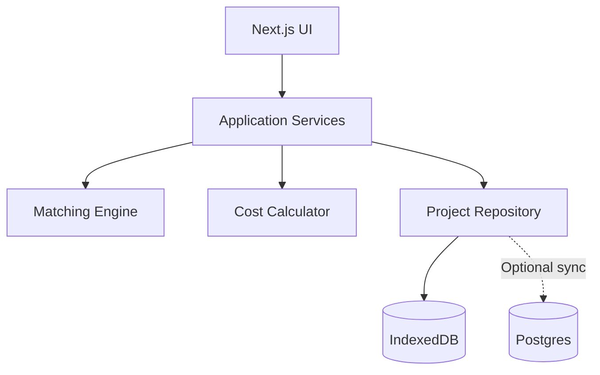

# KosMatch — Technical Architecture

## 1. Architecture Goals

The system should be a polished, explainable portfolio MVP that is:

- usable without sign-up;
- deterministic and transparent;
- privacy-conscious;
- resilient to incomplete input;
- responsive and accessible;
- simple to deploy and demonstrate;
- structured so optional account sync can be added later.

Use a modular monolith. Do not introduce web scraping, machine-learning services, microservices, or a real-time marketplace backend.

## 2. Recommended MVP Stack

| Layer | Choice | Reason |
| --- | --- | --- |
| Framework | Next.js App Router + TypeScript | One codebase for public pages, application routes, and optional server features |
| Styling | Tailwind CSS | Responsive, token-driven styling |
| Accessible primitives | shadcn/ui or Radix-based primitives | Dialog, select, tooltip, sheet, and menu behavior |
| Forms | React Hook Form + Zod | Structured multi-step input and safe validation |
| Local persistence | IndexedDB through a small repository adapter | Works without account and handles structured projects better than raw localStorage |
| State | React state plus a thin project store | Avoid unnecessary global-state complexity |
| Icons | Lucide | Consistent icon family |
| Date and currency | Native `Intl` APIs | Indonesian formatting without heavy dependencies |
| Unit/component tests | Vitest + Testing Library | Matching engine and UI behavior |
| End-to-end tests | Playwright | Complete comparison journey |
| Deployment | Vercel | Simple public portfolio deployment |

Optional post-MVP account sync may use Supabase Auth and Postgres behind the same repository interface. It must not block the core prototype.

Use stable versions generated by the current official scaffolding. Avoid secrets in the client bundle and never commit production environment files.

## 3. High-level Architecture



Key separation:

- UI collects and presents data;
- application services orchestrate use cases;
- calculators contain pure deterministic rules;
- repository adapters handle persistence;
- the matching engine never reads from browser APIs or database clients directly.

## 4. Suggested Project Structure

```text
src/
  app/
    (marketing)/
      page.tsx
      methodology/
    (app)/
      projects/
        new/
        [projectId]/
          page.tsx
          preferences/
          options/
          compare/
          decision/
          share/
  components/
    ui/
    layout/
    feedback/
  features/
    projects/
    preferences/
    options/
    comparison/
    decisions/
    sharing/
  domain/
    entities/
    scoring/
    costing/
    validation/
  data/
    repositories/
    indexeddb/
    demo/
  lib/
    currency/
    dates/
    ids/
    errors/
  types/
tests/
  unit/
  integration/
  e2e/
```

Within a feature, prefer:

- `components/` for domain UI;
- `schemas.ts` for input validation;
- `services.ts` for use-case orchestration;
- `mappers.ts` only when persistence and domain types differ;
- `constants.ts` for stable allowlists.

## 5. Core Domain Types

All money values are stored as integer Rupiah, never floating-point currency.

```ts
type Importance = 1 | 2 | 3 | 4 | 5;

type CriterionKey =
  | "cost"
  | "commute"
  | "facilities"
  | "environment"
  | "ruleFit";

type DataOrigin = "confirmed" | "estimated" | "unknown";

type RequirementLevel = "required" | "desired";

type VerificationStatus = "unverified" | "confirmed" | "changed";

type MoneyValue = {
  amount: number | null;
  origin: DataOrigin;
};
```

Never encode unknown cost as `0`. Use `null` plus `origin: "unknown"`.

### `ComparisonProject`

```ts
type ComparisonProject = {
  id: string;
  name: string;
  destinationLabel: string;
  monthlyBudget: number;
  maxOneWayCommuteMinutes: number;
  commuteDaysPerMonth: number;
  weights: Record<CriterionKey, Importance>;
  facilityPreferences: FacilityPreference[];
  rulePreferences: RulePreference[];
  favoriteOptionId: string | null;
  createdAt: string;
  updatedAt: string;
};
```

### `AccommodationOption`

```ts
type AccommodationOption = {
  id: string;
  projectId: string;
  name: string;
  area: string;
  sourceUrl: string | null;
  lastCheckedAt: string | null;
  rent: MoneyValue;
  electricity: MoneyValue;
  water: MoneyValue;
  internet: MoneyValue;
  laundry: MoneyValue;
  otherRecurring: MoneyValue;
  deposit: MoneyValue;
  administrationFee: MoneyValue;
  oneWayCommuteMinutes: number | null;
  roundTripTransportCost: MoneyValue;
  facilityCodes: string[];
  ruleValues: Record<string, boolean | "unknown">;
  environmentRating: 1 | 2 | 3 | 4 | 5 | null;
  notes: string;
  pros: string[];
  concerns: string[];
  verificationQuestions: VerificationQuestion[];
  shortlisted: boolean;
  createdAt: string;
  updatedAt: string;
};
```

### Derived results

```ts
type CostResult = {
  knownMonthlyTotal: number;
  hasUnknownMonthlyValues: boolean;
  unknownMonthlyFields: string[];
  monthlyTransport: number | null;
  knownMoveInTotal: number;
  unknownMoveInFields: string[];
};

type CriterionResult = {
  key: CriterionKey;
  score: number | null;
  weight: Importance;
  explanation: string;
};

type MatchResult = {
  optionId: string;
  eligible: boolean;
  missingRequiredFacilities: string[];
  criteria: CriterionResult[];
  score: number | null;
  confidence: "high" | "medium" | "low";
  strengths: string[];
  tradeoffs: string[];
};
```

Derived results must not be persisted as the source of truth. Recalculate them whenever project preferences or option data changes.

## 6. Cost Calculation

### Monthly transport

```ts
monthlyTransport = roundTripTransportCost * commuteDaysPerMonth;
```

If either value is unknown, monthly transport is unknown.

### Known monthly total

```ts
knownMonthlyTotal =
  rent +
  electricity +
  water +
  internet +
  laundry +
  otherRecurring +
  monthlyTransport;
```

Only known values contribute numerically. The result must carry `hasUnknownMonthlyValues: true` when any component is unknown, and the UI must display `minimum known estimate` rather than implying completeness.

### Move-in total

Show these separately:

- deposit;
- administration fee;
- first rent payment if applicable;
- optional moving expense only if explicitly entered.

Do not amortize them into monthly cost by default.

### Simulation

Simulation receives a copy of project/option inputs and returns a derived result. It must not mutate persisted data unless the user confirms `Terapkan perubahan`.

## 7. Matching Algorithm

The algorithm is deterministic, documented, and implemented as pure functions.

### 7.1 Eligibility

```ts
eligible = requiredFacilityCodes.every(code =>
  option.facilityCodes.includes(code)
);
```

Unknown availability for a required facility is treated as not yet eligible, with the reason `Perlu dikonfirmasi`, rather than assumed absent.

### 7.2 Cost score

When the monthly total is complete:

```ts
costScore = monthlyTotal <= budget
  ? 100
  : clamp(100 * (2 * budget - monthlyTotal) / budget, 0, 100);
```

Interpretation:

- at or below budget: 100;
- 1.5× budget: 50;
- 2× budget or above: 0.

If important monthly values are unknown, the cost criterion score is `null`, not an optimistic estimate.

### 7.3 Commute score

```ts
commuteScore = commuteMinutes <= maxMinutes
  ? 100
  : clamp(100 * (2 * maxMinutes - commuteMinutes) / maxMinutes, 0, 100);
```

If commute time is unknown, the score is `null`.

### 7.4 Facility score

Required facilities control eligibility and are not double-counted as desired facilities.

```ts
facilityScore = desiredFacilities.length === 0
  ? null
  : 100 * matchedDesiredFacilities.length / desiredFacilities.length;
```

### 7.5 Environment score

```ts
environmentScore = rating === null ? null : rating * 20;
```

### 7.6 Rule-fit score

Only known rules are included in the denominator.

```ts
ruleFitScore = knownPreferences.length === 0
  ? null
  : 100 * matchedKnownPreferences.length / knownPreferences.length;
```

Unknown rules reduce confidence but do not count as a mismatch.

### 7.7 Weighted score

```ts
const scoredCriteria = criteria.filter(item => item.score !== null);

matchScore = scoredCriteria.length === 0
  ? null
  : sum(item.score * item.weight) / sum(item.weight);
```

Round to a whole number only for display. Sort eligible options before ineligible options, then by score, then by data confidence, then alphabetically for deterministic ties.

### 7.8 Confidence

Define a stable completeness calculation based on key fields:

- rent;
- recurring utilities/services;
- commute time;
- transport cost;
- required facility status;
- selected rule status.

Suggested thresholds:

- high: at least 90% complete and rent/commute confirmed;
- medium: 65–89% complete with no more than one key unknown;
- low: below 65% complete or rent/commute unknown.

Confidence is separate from Match Score and cannot increase it.

## 8. Explanation Generation

Use rule-based templates, not generative AI.

The explanation service receives `CostResult`, `MatchResult`, and labels, then returns:

- up to two strengths;
- up to two trade-offs;
- missing required needs;
- missing high-impact data;
- a concise overview sentence.

Prioritize messages by user weight and severity. A missing required facility always appears before a favorable low-weight criterion.

Example rules:

- cost score 100 and cost has highest weight → `Total bulanan masih dalam anggaran Anda.`
- commute score under 50 → `Perjalanan jauh melebihi batas yang Anda pilih.`
- unknown electricity with high cost weight → `Biaya listrik belum diketahui sehingga skor biaya belum dapat dihitung.`
- one missing required facility → `Belum memenuhi kebutuhan wajib: kamar mandi dalam.`

Keep explanation templates covered by tests and separate from visual components.

## 9. Persistence Architecture

Define a repository interface:

```ts
interface ProjectRepository {
  listProjects(): Promise<ComparisonProject[]>;
  getProject(id: string): Promise<ComparisonProject | null>;
  saveProject(project: ComparisonProject): Promise<void>;
  deleteProject(id: string): Promise<void>;
  listOptions(projectId: string): Promise<AccommodationOption[]>;
  getOption(id: string): Promise<AccommodationOption | null>;
  saveOption(option: AccommodationOption): Promise<void>;
  deleteOption(id: string): Promise<void>;
}
```

### IndexedDB adapter

- database name: `kosmatch`;
- schema version is explicit;
- stores: `projects`, `options`, `settings`;
- indexes: `options.projectId`, `projects.updatedAt`;
- migration functions handle schema changes;
- repository methods return domain objects, not raw database records.

### In-memory adapter

Use for unit tests and static demo snapshots.

### Optional cloud adapter

May be implemented after MVP with user-owned rows and strict authorization. Do not mix anonymous local identifiers and server identifiers without a documented migration/sync strategy.

## 10. Export and Sharing

### MVP export

Use a print-optimized summary page and browser print-to-PDF. This avoids fragile server-side PDF generation.

Summary includes:

- project preference summary;
- selected options;
- monthly and move-in costs;
- criterion results;
- trade-offs and unknown values;
- generated date;
- estimation disclaimer.

Exclude source URLs and private notes by default. Offer explicit toggles before generating.

### Optional share link

If implemented, create a sanitized snapshot with:

- cryptographically random token;
- expiry or manual revoke capability;
- read-only access;
- no account email or private metadata;
- rate-limited lookup.

This is post-MVP and must not delay the local comparison flow.

## 11. Validation Rules

- all IDs use UUIDs or collision-resistant IDs;
- currency is an integer from 0 to a documented safe maximum;
- distinguish zero from unknown;
- project name: 1–80 characters after trimming;
- option name: 1–100 characters;
- notes: maximum 3000 characters;
- commute days: 0–31;
- commute minutes: 0–360 one way;
- importance: integer 1–5;
- environment rating: integer 1–5 or null;
- source URL accepts only `http` or `https`;
- last-checked date cannot be unreasonably in the future;
- selected facilities and rules come from allowlisted codes;
- sanitize imported JSON before storage;
- prevent one project's option from appearing in another project.

## 12. Import, Export, and Recovery

Allow a user to export one project as versioned JSON for backup and import it later.

```ts
type KosMatchExport = {
  format: "kosmatch-project";
  version: 1;
  exportedAt: string;
  project: ComparisonProject;
  options: AccommodationOption[];
};
```

Import flow:

1. parse JSON safely;
2. validate the entire structure;
3. show a preview;
4. assign new IDs to avoid collisions;
5. persist only after confirmation;
6. show clear errors without partially importing invalid data.

## 13. Rendering and State Strategy

- use Server Components for marketing and methodology pages;
- use Client Components for browser-stored project data and interactive comparisons;
- load IndexedDB through a repository provider after hydration;
- show skeletons while local data initializes;
- keep multi-step form draft state separate from saved data;
- use URL search parameters for compare selections when safe;
- keep selected option IDs in the URL, not the full option data;
- use memoized pure selectors for derived scores;
- never persist calculated scores as authoritative values.

## 14. Error Handling

Define user-safe errors:

- storage unavailable;
- storage quota exceeded;
- corrupt imported file;
- project or option not found;
- invalid source URL;
- incomplete scoring data;
- export failed;
- optional share link expired.

Provide recovery:

- retry storage initialization;
- download emergency JSON backup when possible;
- return to project list;
- restore unsaved form data from current-session draft;
- never discard existing data on migration failure.

## 15. Privacy and Security

- core anonymous data stays on the device;
- do not collect exact home or office coordinates;
- do not execute or preview untrusted source URLs inside the app;
- external links use safe attributes and clear destination labels;
- sanitize imported data and rendered text;
- avoid analytics payloads containing project names, option names, notes, URLs, or cost values;
- add Content Security Policy and secure headers where practical;
- no scraping credentials or third-party marketplace cookies;
- demo mode never loads real user data;
- show a clear local-data deletion action with confirmation.

## 16. Testing Strategy

### Unit tests

- monthly transport calculation;
- known and unknown monthly totals;
- move-in cost separation;
- eligibility for required and unknown facilities;
- every criterion formula at boundaries;
- weighted score with missing criteria;
- deterministic tie sorting;
- confidence thresholds;
- explanation priority;
- Indonesian currency formatting.

### Property/invariant tests

- score always remains between 0 and 100;
- raising a weight cannot affect unrelated criterion scores;
- an unknown value is never treated as zero;
- adding a missing required facility can change eligibility from false to true;
- increasing cost above budget cannot improve cost score;
- increasing commute above the limit cannot improve commute score.

### Integration tests

- create project and persist preferences;
- add/edit/delete option;
- data remains after page reload;
- an option appears only in its project;
- changing preferences recalculates all results;
- JSON export/import round trip;
- invalid import does not alter saved data.

### End-to-end tests

1. Start without sign-up and create a project.
2. Set required facilities and priority weights.
3. Add three fictional options with one unknown cost.
4. Verify eligibility grouping and score explanation.
5. Compare three options at desktop and mobile widths.
6. Shortlist and mark a favorite.
7. Run a cost simulation without overwriting the saved option.
8. Print or export a decision summary.

### Accessibility tests

- automated axe checks where practical;
- complete onboarding and option entry by keyboard;
- verify table headers in desktop comparison;
- verify mobile comparison reading order;
- test 200% zoom and 360 px viewport;
- verify text alternatives for score visualization.

## 17. Performance Targets

- avoid loading heavy map or chart libraries;
- keep scoring synchronous and fast for at least 100 local options;
- calculate results in pure memoized selectors;
- dynamically load print/export-only UI;
- avoid large property-image galleries;
- reserve layout space to prevent shift;
- keep initial marketing page lightweight;
- paginate or virtualize only if real data volume proves necessary.

## 18. Implementation Phases

### Phase 1 — Foundation

- scaffold application;
- implement tokens and responsive shell;
- define domain types and validation;
- implement in-memory repository;
- build and test cost/scoring engine;
- add fictional demo fixture.

### Phase 2 — Complete core flow

- preference onboarding;
- IndexedDB repository and migrations;
- accommodation option form with unknown-value handling;
- results ranking and explanation;
- empty/loading/error states.

### Phase 3 — Decision tools

- responsive comparison;
- shortlist and favorite;
- verification questions;
- cost simulation;
- print-friendly summary.

### Phase 4 — Portfolio polish

- accessibility audit;
- responsive QA;
- unit, integration, and end-to-end tests;
- landing and methodology pages;
- README, screenshots, limitations, and research evidence;
- deployment.

### Optional Phase 5 — Account sync

- authentication;
- cloud repository adapter;
- row-level authorization;
- explicit local-to-cloud migration;
- revocable read-only sharing.

Do not start Phase 5 until Phases 1–4 are complete and stable.

## 19. AI Agent Implementation Rules

The coding agent must:

- read `KosMatch-description.md`, `KosMatch-design.md`, and `KosMatch-architecture.md` before coding;
- treat product boundaries and unknown-data behavior as hard requirements;
- build the scoring engine with tests before the ranking interface;
- implement one complete vertical slice before adding secondary features;
- keep TypeScript strict and avoid `any`;
- store currency as integer Rupiah;
- keep calculations pure and separate from React components;
- use repository interfaces rather than direct IndexedDB access in UI;
- use migrations for local database schema changes;
- use fictional demo data only;
- provide `.env.example` if optional external services are introduced;
- implement responsive, loading, empty, error, and accessibility states;
- run lint, typecheck, unit tests, and focused E2E tests after changes;
- report assumptions and deviations;
- never scrape marketplaces, fabricate research, invent missing costs, or claim unfinished controls work;
- not add AI recommendations merely for novelty.

## 20. Suggested Initial Agent Prompt

> Build KosMatch using `KosMatch-description.md` as the product source of truth, `KosMatch-design.md` as the UX contract, and `KosMatch-architecture.md` as the technical contract. Audit the repository and propose a concise phased plan. Then implement Phase 1 and the first complete vertical slice: a user starts without signing in, defines budget and priorities, adds two fictional accommodation options, sees transparent monthly-cost and Match Score calculations, understands unknown values, and compares the options. Begin with tested pure calculation functions and an in-memory repository before browser persistence. Keep the app runnable, responsive, accessible, and honest about estimated or missing data. Do not add marketplace scraping, booking, AI-generated facts, or optional account sync.

