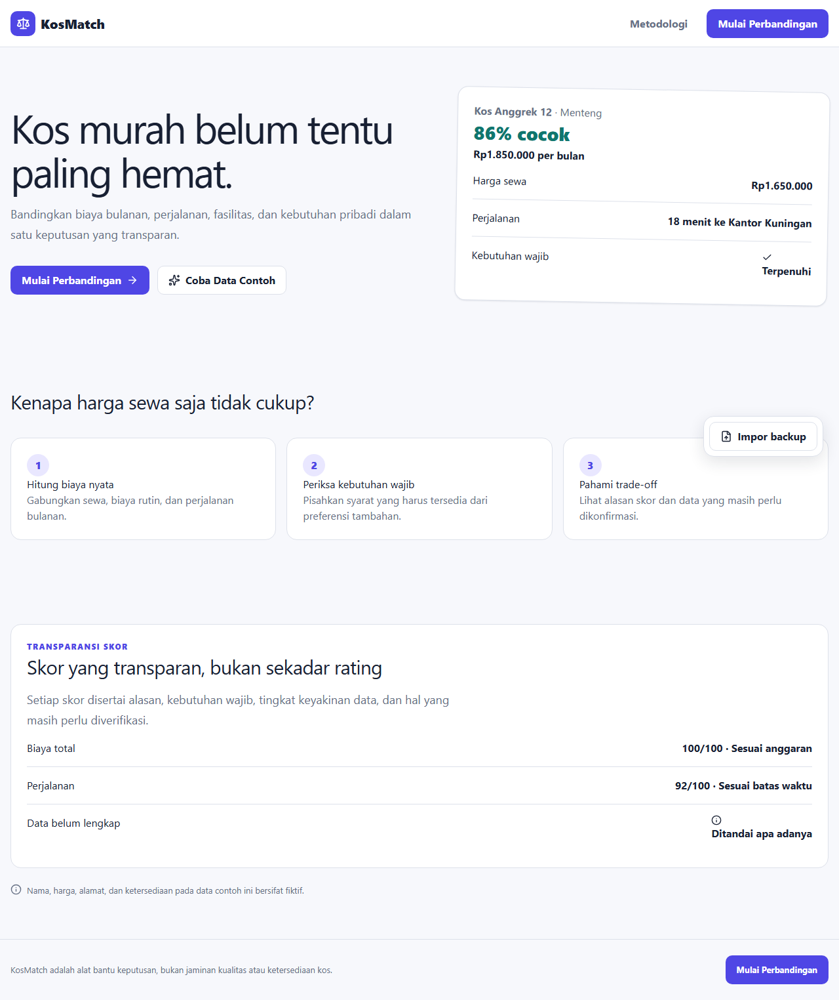

# KosMatch

KosMatch adalah aplikasi web pendukung keputusan untuk membandingkan pilihan kos berdasarkan biaya bulanan sebenarnya, perjalanan, fasilitas wajib, lingkungan, dan kecocokan aturan. KosMatch bukan marketplace dan tidak memilihkan “kos terbaik” secara mutlak.



## Fitur MVP

- penggunaan anonim tanpa sign-up;
- onboarding preferensi empat langkah dan pengeditan preferensi;
- beberapa proyek dengan project switcher dan pemulihan proyek aktif;
- tambah, edit, hapus, dan draft sesi pilihan kos;
- status biaya `dikonfirmasi`, `perkiraan`, atau `belum diketahui`;
- kalkulasi biaya bulanan dan biaya awal yang terpisah;
- eligibility fasilitas wajib, Match Score, confidence, dan penjelasan rule-based;
- sort, filter, detail, dan perbandingan responsif untuk 2–3 pilihan;
- shortlist, favorit, pro, kekhawatiran, dan pertanyaan verifikasi;
- simulator biaya non-mutating dengan aksi penerapan eksplisit;
- ringkasan print/PDF yang mengecualikan URL serta catatan privat;
- backup dan pemulihan proyek melalui JSON tervalidasi;
- data demo fiktif dan halaman metodologi publik.

## Menjalankan proyek

Persyaratan: Node.js 20.19+, 22.13+, atau versi LTS yang lebih baru direkomendasikan.

```bash
npm install
npm run dev
```

Buka `http://localhost:3000`.

## Quality gates

```bash
npm run typecheck
npm run lint
npm test
npm run build
npx playwright install chromium
npm run test:e2e
```

Unit dan integration test mencakup kalkulasi biaya, formula pada boundary, invariant skor, confidence, repository in-memory/IndexedDB, simulator, decision tools, serta import/export atomik. Playwright menjalankan core flow pada desktop dan mobile, persistence setelah reload, multi-project switching, viewport 360 px, dan automated axe checks.

## Cara kerja skor

Setiap kriteria menghasilkan skor 0–100. Skor akhir adalah rata-rata berbobot dari kriteria yang datanya diketahui:

```text
Match Score = Σ(skor kriteria × bobot)
              / Σ(bobot dengan data diketahui)
```

Nilai yang belum diketahui tidak dianggap nol dan dikeluarkan dari penyebut. Fasilitas wajib menentukan kelayakan secara terpisah dari skor. Confidence menunjukkan kelengkapan/verifikasi data dan tidak menambah Match Score.

Biaya bulanan terdiri dari sewa, utilitas/layanan berulang, serta biaya transportasi pulang-pergi dikalikan jumlah hari perjalanan. Deposit, administrasi, dan pembayaran sewa pertama ditampilkan sebagai biaya awal masuk, bukan dicampur ke biaya bulanan.

Penjelasan lebih lengkap tersedia di halaman `/methodology`.

## Data dan privasi

Data proyek anonim disimpan pada IndexedDB di perangkat pengguna. Backup JSON hanya diimpor setelah validasi penuh dan konfirmasi; ID baru dibuat untuk menghindari collision. Ringkasan cetak tidak menyertakan source URL atau catatan privat secara default.

KosMatch tidak mengumpulkan dokumen identitas, pembayaran, kredensial pemilik, alamat rumah/kantor yang presisi, ataupun cookie marketplace.

## Batasan

- seluruh data demo sepenuhnya fiktif;
- biaya, aturan, kualitas, dan ketersediaan harus dikonfirmasi kepada pemilik kos;
- penilaian lingkungan adalah observasi pribadi pengguna, bukan klaim keamanan;
- belum ada akun atau sinkronisasi cloud karena merupakan Phase 5 opsional;
- tidak ada scraping, booking, pembayaran, chat pemilik, marketplace, maupun routing peta real-time;
- deployment publik membutuhkan akun hosting dan dilakukan terpisah dari source code;
- riset pengguna asli belum dilakukan dan tidak ada metrik yang direkayasa.

## Dokumen sumber

- `KosMatch-description.md` — kontrak produk;
- `KosMatch-design.md` — kontrak UX dan visual;
- `KosMatch-architecture.md` — kontrak teknis.
